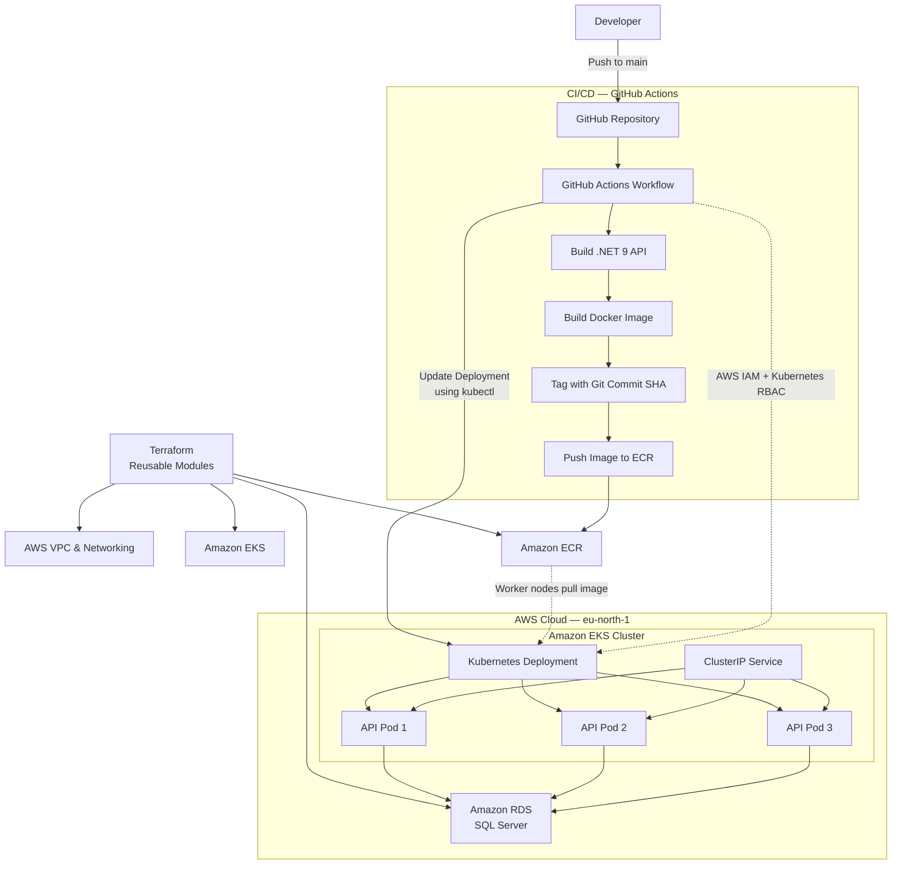

# Engo — DevOps & Cloud Infrastructure

Cloud infrastructure and CI/CD automation for deploying a containerized **.NET 9 Web API** to **Amazon EKS** using Docker, Amazon ECR, Kubernetes, Terraform, and GitHub Actions.

This project demonstrates an end-to-end deployment workflow, from source code changes to automated container builds and Kubernetes deployments on AWS.

## Architecture

The infrastructure is provisioned using Terraform, while GitHub Actions automates the application build, container publishing, and Kubernetes deployment.



## Tech Stack

| Category | Technologies |
|---|---|
| Cloud Provider | AWS |
| Infrastructure as Code | Terraform |
| Containerization | Docker |
| Container Registry | Amazon ECR |
| Container Orchestration | Kubernetes, Amazon EKS |
| CI/CD | GitHub Actions |
| Cloud Security | AWS IAM, Kubernetes RBAC |
| Application | .NET 9 Web API |
| Database | Amazon RDS (SQL Server) |
| Operating System | Linux |

## Key Features

### 1. AWS Infrastructure

- Provisioned AWS infrastructure using Terraform.
- Organized Terraform configuration into reusable modules.
- Configured networking resources, including VPCs and subnets.
- Integrated Amazon ECR for container image storage.
- Deployed an Amazon EKS cluster with a Managed Node Group.
- Configured Amazon RDS for SQL Server database hosting.

### 2. Docker Containerization

- Created a multi-stage Dockerfile for the .NET 9 API.
- Separated build and runtime environments.
- Optimized the Docker build context using `.dockerignore`.
- Used lightweight ASP.NET runtime images for the final container.

### 3. CI/CD with GitHub Actions

Implemented an automated deployment pipeline triggered by pushes to the `main` branch.

Pipeline workflow:

1. Check out the source code.
2. Configure AWS credentials.
3. Authenticate with Amazon ECR.
4. Build the Docker image.
5. Tag the image using the Git commit SHA.
6. Push the image to Amazon ECR.
7. Configure `kubectl` access to Amazon EKS.
8. Update the Kubernetes Deployment.
9. Verify deployment success using `kubectl rollout status`.

### 4. Kubernetes Deployment

- Deployed the .NET API to Amazon EKS.
- Configured a Kubernetes Deployment with three replicas.
- Used ClusterIP Services for internal application communication.
- Managed application configuration through ConfigMaps.
- Stored sensitive application settings in Kubernetes Secrets.
- Verified successful rollouts and Pod readiness.

### 5. Security & Access Management

- Configured AWS IAM permissions for GitHub Actions.
- Restricted ECR permissions to the application repository.
- Integrated the deployment IAM user with the EKS `aws-auth` ConfigMap.
- Implemented Kubernetes RBAC with namespace-scoped deployment permissions.
- Kept application credentials outside the source code.

## CI/CD Pipeline

Every push to `main` triggers the following workflow:

```text
Git Push
   |
   v
GitHub Actions
   |
   v
Build .NET 9 API
   |
   v
Build Docker Image
   |
   v
Tag with Git Commit SHA
   |
   v
Push to Amazon ECR
   |
   v
Update Amazon EKS Deployment
   |
   v
Kubernetes Rollout Verification
```

Images are tagged with the Git commit SHA to identify deployment versions and support traceability.

## Repository Structure

```text
Engo/
├── .github/
│   └── workflows/
│       └── deploy.yml
│
├── infrastructure/
│   ├── docker/
│   │   └── Dockerfile
│   │
│   ├── kubernetes/
│   │   ├── Deployment.yaml
│   │   ├── Service.yaml
│   │   └── github-actions-rbac.yaml
│   │
│   └── terraform/
│       ├── modules/
│       └── ...
│
├── Engli3m/
├── Engli3m.Application/
├── Engli3m.Domain/
├── Engli3m.Infrastructure/
│
└── README.md
```

## Deployment Verification & Results

The deployment was successfully verified on Amazon EKS.

**Verified deployment results:**

| Metric | Result |
|---|---|
| End-to-end deployment time | 58 seconds |
| Desired replicas | 3 |
| Ready replicas | 3 |
| Pod restarts | 0 at verification time |
| Deployment status | Successfully rolled out |

The 58-second measurement represents the deployment duration from workflow execution until the application Pods became ready.

Verification commands:

```bash
kubectl get pods -n default
```

```bash
kubectl rollout status deployment/engli3m-api -n default
```

## GitHub Actions Configuration

Configure the following repository secrets:

| Secret | Description |
|---|---|
| `AWS_ACCESS_KEY_ID` | AWS IAM access key |
| `AWS_SECRET_ACCESS_KEY` | AWS IAM secret access key |

The workflow also uses the following AWS configuration:

- AWS Region: `eu-north-1`
- ECR Repository: `engli3m-api`
- EKS Cluster: `engli3m-dev`
- Kubernetes Namespace: `default`

Never commit AWS credentials, database passwords, JWT keys, or Firebase credentials to the repository.

## What I Learned

Through this project, I gained practical experience with:

- Building and deploying containerized applications.
- Automating CI/CD workflows using GitHub Actions.
- Managing AWS infrastructure with Terraform.
- Working with Amazon EKS and Kubernetes resources.
- Managing container images with Amazon ECR.
- Configuring IAM permissions and Kubernetes RBAC.
- Troubleshooting Docker builds, ECR permissions, and Kubernetes deployments.
- Verifying automated deployments and Kubernetes rollout status.

## Project Status

**Successfully deployed and verified on Amazon EKS using an automated GitHub Actions CI/CD pipeline.**

The AWS infrastructure was subsequently decommissioned to avoid ongoing cloud costs. The source code and deployment configuration remain available for review.

---

Developed as a hands-on DevOps and Cloud Engineering project.
